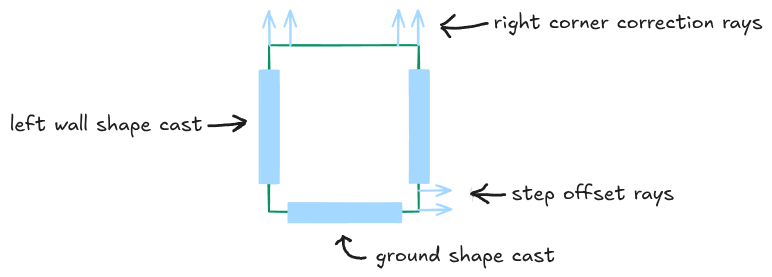

# Dev Log #2: Movment

*Published on October 23, 2026 by **Nolan Willis***

## Items Included in the Vertical Slice
- Movement that feels really good and is fun to use.
- Health/dying/respawning.  
- The default abilities: piano string and slash. The piano string is used like a whip, for swinging and pulling the player towards surfaces and enemies. Slash is a quick close quarters attack.  
- An unlockable movement ability.
- An unlockable attack ability.
- Enemies: flying, slow ground, normal ground, and a fast ground enemy. 
- A puzzle. 
- An NPC with dialog and a quest that unlocked the movement and attack ability. 
- A boss fight.
- Basic sounds. 
- Basic HUD. 
- Ability selection screen.
- Saving data.   
- And maybe more…

First on the list is movement. Arguably the most important since you’re constantly using it throughout the game; if it feels clunky or annoying, it will taint the rest of the experience. 

## Movement Features 

Games with movement in two dimensions have been around for a long time, there are many different features employed to make movement feel good, this is what I’m using for now: 
- Variable gravity depending on the player’s movement state.
- Variable speed depending on the player's movement state. 
- Acceleration or the feeling of acceleration by lerping between velocity so movement isn’t instant. 
- Coyote time: the ability to fall off a ledge and jump for a short period of time. 
- Jump buffering: the ability to click jump right before hitting the ground and the jump - counting. 
- Corner correction: gives the player a small boost left or right, if they catch a small corner of a platform at their feet.
- Step offset: similar to corner correction, gives the player a boost upward if they catch the corner of a platform in front of them.
- Variable jump force: the longer you hold the button the higher your jump (more for difficulty, might not include it). 

## Character Setup



This is the character setup I ended up with. Keep in mind this picture is not including the `CollisionShape2D` around the player, to prevent them from falling though the floor or going through walls. Here’s how each piece contributes to the movement features talked about above: 

Corner Correction Rays
- If the outer ray hits a ground or ceiling collider and its corresponding inner ray does not, then corner correction is triggered.
- If the right pair of rays trigger corner correction, the player is shifted to the left. If the left pair triggers it, the player is shifted to the right.
- The area between the rays is the amount of platform the player’s “shoulder” can catch and be corrected.
- Prevents the frustrating situation where you almost jump past a platform but get caught only by the slightest amount. 

Step Offset Rays
- Similar purpose as corner correction rays, but shifts the player up to avoid small variations in the ground terrain. 
- Instead of having four ray casts for the step offset this setup uses two that change direction based on player input.          

Ground Shape Cast
- Simply updates the grounded flag, used to determine if the player can jump and when to transition from falling back to idle or walking. 

Wall shape Casts 
- Used to detect walls the player is colliding with and enable wall running.  


## States, States, and more States 

You could attempt to implement movement using if statements and a single script, but it would end up being an indentation/ordering clusterfuck, that will be impossible to debug in three weeks when you completely forget how any of it was implemented in the first place. 

Instead, I used the state pattern, which will be used in many other parts of the project down the road. To start I implemented a basic state interface. GDScript doesn't have interfaces like Java or C#, in fact this is more like an abstract class than an interface since the methods aren't strictly required to be implemented by children, but I digress, here it is: 

```
class_name State

func enter() -> void:
	pass

func process(_delta: float) -> void:
	pass

func physics_process(_delta: float) -> void:
	pass

func exit() -> void:
	pass
```

`enter()` is called when the state is switched to, `process()` and `physics_process()` serve the same function as any other node, and `exit()` is called when a new state is switched to. This is a good start, but I also needed a way to uniquely identify each state and jumping becomes an issue. It’s easy enough to check for the jump key in the `process()` function of each state that allows the user to jump, but when you add jump buffering and variable jump force you end up duplicating a lot of code. For these two reasons I decided to make a child class of State, creatively named Movement State, that looks like the following:   

```
class_name MovementState
extends State

enum StateName {
	IDLE,
	WALKING,
	JUMPING,
	APEXING,
	FALLING,
	WALL_RUNNING,
	WALL_JUMPING,
	NULL
}

var state_name: StateName

func _init(in_state_name: StateName) -> void:
	state_name = in_state_name

func jump() -> void:
	pass

func get_state_name() -> StateName:
	return state_name
```

If the state doesn’t let the user jump, it simply doesn't override the jump function. I suppose you could have the jump in the movement controller itself and implement a switch, jumping according to the current state, but this solution is much cleaner. It’s also much easier to add more movement states down the road. 

The Movement Script

movement.gd is attached to the player and is responsible for creating the movement states, keeping track of the current movement state, housing all the data the movement states use, and providing a public function for switching movement states, so you don’t have to remember to call `enter()` and `exit()`. 

`process()` of the movement controller is worth highlighting here: 

```
func _process(delta: float) -> void:
	## If the jump key is down update the flag.
	if Input.is_action_pressed("jump"):
		is_jump_pressed = true
	## If the jump key was pressed then released.
	elif is_jump_pressed:
		last_jump_pressed_time = Time.get_ticks_msec() / 1000.0
		_current_state.jump()
		is_jump_pressed = false
		current_jump_force = min_jump_force
	## If the jump key is down increment the jump force until we hit the max.
	if is_jump_pressed and current_jump_force < max_jump_force:
		current_jump_force += jump_force_increment * delta

	move_input = Input.get_vector("move_left", "move_right", "move_up", "move_down")

	update_is_grounded()

	if _is_grounded:
		last_grounded_time = Time.get_ticks_msec() / 1000.0

	last_wall_direction = 1.0 if is_wall_to_right() else -1.0

	_current_state.process(delta)
```

1. When the jump key is down, `is_jump_pressed` is set to true. 
2. If `is_jump_pressed` is true and `max_jump_force` is not reached, increment `current_jump_force`. 
3. When the jump key is not pressed after `is_jump_pressed` was set to true, that means the player released the jump key and it’s time to jump.
4. `last_jump_pressed_time` is recorded, which is used in jump buffering (more on this below). 
5. The current states’ `jump()` is called (if the state can jump, `jump()` just transitions to the jump state which adds the jump force in `enter()`).
6. `current_jump_force` is reset. 

## Jump Buffering

Out of all the movement features listed, jump buffering was the most confusing to me. Basically when the player wants to jump, if the current movement state allows jumping, its `process()` transitions to the jump movement state if they are grounded and a jump is buffered. A jump is buffered If the current time - `last_jump_pressed_time` is under a certain threshold. 

How does this help the player? 

If the player hits jump while idle, the movement state is switched to jumping, the `last_jump_pressed_time` is set to zero and the player jumps. But if the player jumps while falling, `last_jump_pressed_time` is recorded and the movement state is switched to idle when we hit the ground. In Idle’s `process()`, jump is transitioned to if the player is grounded (which they now are) and a jump is buffered, which it will be if the time since `last_jump_pressed_time` is below a certain threshold. 

In other words, if the player clicks jump right before hitting the ground, the player will jump. This makes it much easier on the player to chain jumps in a fast moving environment. This technique is also known as input buffering, and it could be applied to more than just jumping.         

This obviously isn’t the complete movement controller implementation. I just wanted to highlight the important parts and some of the challenges encountered. There’s still a lot of fine tuning to do value wise, and there might be more movement features added or removed down the line, but it seems to be in a good enough spot to move on.
