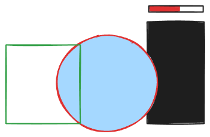
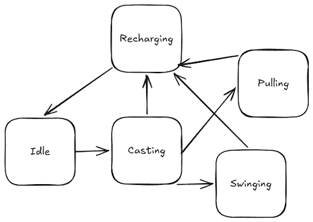
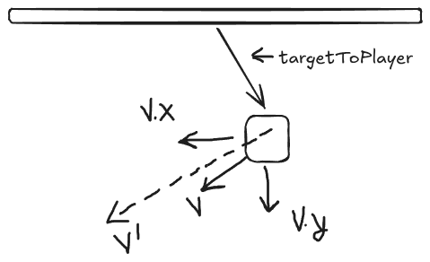

# Dev Log #3: Default Abilities and Health 

*Published on October 30, 2026 by **Nolan Willis***

The first major milestone of the vertical slice is getting a basic encounter between the player and an enemy. So after movement, I started on the first two default abilities, slash and piano string, and built a very basic health component that can be used by the player and enemies.   

Admittedly, the first implementation of these items is crude. The abilities are just nodes slotted on the player with hard coded inputs. In the future, I’d like to implement an ability system, where swapping out abilities, rebinding keys, unlocks and energy costs are all taken into consideration. Health, however, is pretty much done (not including lives, respawning, etc).     

## Health  

The slash ability interacts with the health “system” so it makes sense to go into health first. I’m using quotes here because it’s not that intricate. It consists of three basic elements: 

Hitbox: an Area2D with a damage and cooldown variable. Created by the thing doing damage. 

Hurtbox 
- An Area2D, with a reference to the health component of the thing it’s attached to, and a dictionary with each hit box overlapped and when they were overlapped.  
- When the hit box overlaps again, we check the recorded time, compare it with the current time and cooldown specified in the hit box, and call damage on the health component.  
- Placed on the thing receiving damage.  

Health 
- A node that keeps track of current health, maximum health, and death status. 
- Provides an interface for changing current and maximum health. 
- Has three signals. One for updating the UI, another for reacting to damage (flashing red, knockback, hurt anim, etc), and a third for dying.

health.gd 

```
class_name Health
extends Node

signal health_changed(current: int, max: int, delta: int)
signal damaged(amount: int, source: Node)
signal died

@export var max_health: int = 100
var current_health: int

func _ready() -> void:
	current_health = max_health

func damage(amount: int, source: Node) -> void:
	if amount <= 0 or is_dead():
		return
	_set_health(current_health - amount)
	damaged.emit(amount, source)

func heal(amount: int) -> void:
	if amount <= 0 or is_dead():
		return
	_set_health(current_health + amount)

func is_dead() -> bool:
	return current_health <= 0

func set_max_health(value, heal_to_full: bool = false) -> void:
	max_health = value
	if heal_to_full: _set_health(value)

func _set_health(value: int) -> void:
	var old := current_health
	current_health = clampi(value, 0, max_health)
	if current_health == old:
		return
	health_changed.emit(current_health, max_health, current_health - old)
	if current_health == 0:
		died.emit()
```

The interface exposed to other components is very clear. Instead of a single set health function and dealing with negatives, it delegates to `_set_health()` through `damage()` and `heal()`. Another reason for this was that the damage signal requires the source node, so listeners know who caused the damage. Having a single set health would mean having a useless parameter in the heal case.   

## Slash   

The slash ability is really simple, it activates the circular collider of a hit box on the left or right side of the player. Before doing this, the concept of which direction the character is facing had to be added to the movement component, so slash knows which side to put the collider on. This was done by adding `facing` to the movement component, which remembers the last value of `move_input.x`. 



## Piano String 

The piano string includes five different states, interacts with the movement system, and has two different use cases: pulling and swinging. The initial goal of this ability was to create a whip-like movement ability without the restriction of anchor points. 

As I was implementing this, Castlevania: Belmont’s Curse came out. The main character has a whip ability which can attach to anchors for swinging, but can also hook to enemies and be paired with an attack. Similar to what this ability is for. It was extremely satisfying to use and the anchor points, which were not as clunky as expected. In fact, the anchor points seem to help the player in three ways: it kinda shows you where to go, it tells you: “hey you need the whip to get here”, and it pretty much guarantees if you hit anchor x, you will reach platform y. My implementation is similar, but the whip can attach to any ceiling, wall, or enemy. Given my experience playing Belmont's Curse, it might be restricted to a tighter, more specific area in the future.    

The only thing I didn’t like was using WASD to choose the direction of the whip, which allowed multiple anchors to be placed around the player. It felt really clunky and I often found myself selecting the wrong anchor point. The piano string ability uses mouse location, which is much easier to use but it will require a crosshair or some sort of visual indicator, which most 2D Metroidvania’s don’t have.         

States 

The piano string has a state machine with five states. 
- Idle 
  - `process()`: if the key is pressed, go to casting.
- Casting
  - `enter()`: start hit detection. If we hit nothing go to recharging, if we hit a wall go to pulling, if we hit a ceiling go to swinging. 
- Pulling
  - `enter()`: tell movement controller to switch to null state.
  - `physics_process()`: if distance from target < acceptance radius, go to recharging, otherwise move to target. If we don't move the expected amount and hit something, go to recharging. 
  - `exit()`: tell movement controller to switch to falling state.
- Swinging
  - `enter()`: tell movement controller to switch to null state.
  - `physics_process()`: if we release the key or jump, go to recharging. Check line of sight to the target, if we lost it go to recharging, otherwise apply swing gravity and move the player. 
  - `exit()`: tell movement controller to switch to falling state.    
- Recharging  
  - `enter()`: set local time left variable to recharge_duration.
  - `process()`: subtract delta time from time left, if it's 0 go to idle.  



Once the five states were outlined it was fairly easy to reason about the ability, the only challenge that remained was actually moving the player. For pulling, the math is easy: get the vector from the player to the target, normalize it to get the direction, then multiply the direction vector by pull speed to get the velocity. 

Easy right?  

Swinging, on the other hand, is harder. The player needs to move in a circle around the anchor point. Another way of saying this, is at every update, the player velocity should be tangential to the swing circle. 



To do this, I got the vector from the anchor point to the player, in this case targetToPlayer. The target velocity, or tangential velocity (V') is perpendicular to targetToPlayer. To change the current velocity to the target velocity, I took the dot product of the current velocity vector, v, with the direction of targetToPlayer. This gives the amount that v, is in the direction of targetToPlayer, which needs to be removed. To do this, I multiplied the dot product by the direction of targetToPlayer, then subtracted that from the current velocity. Then all the was needed was to make sure the player stayed within the initial rope length, so they didn’t fall.   

A few more things added for feel:
- Pumping input: while swinging move_left and move_right add a sideways acceleration along the tangent (like pumping a swing).
- Minimum rope length: if the player is too close, the piano string stays slack until it falls to minimum length.
- Exit boost: if the player exits the swing under a certain velocity, it adds a boost in their movement direction when they release the input key or jump.    

There’s not much to change for health and slash, but the piano string definitely needs some more refinement. Adding more abilities, enemies, and larger play spaces will help inform this refinement. My main goal with all abilities is to make them seamless and satisfying to use.
