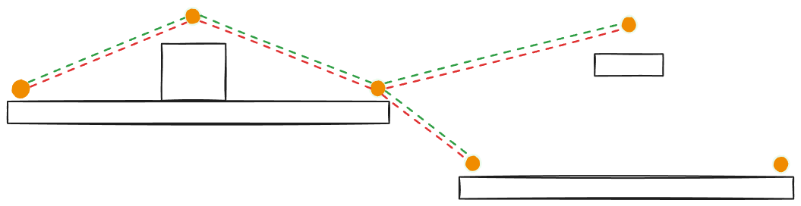
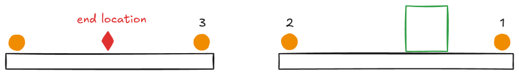

# Dev Log #4: Movment

*Published on November 6, 2026 by **Nolan Willis***

Before going into this, it’s worth noting that this is by no means the most optimal or correct way to implement navigation in Godot for a platform based game. This is just what I came up with from watching YouTube videos, past game AI projects, and bouncing ideas off of Claude Code. It might need to be changed later, but right now it accomplishes the task of providing platform to platform navigation that is relatively easy to set up in the editor. 

## A very quick summary of A*
A* or A Star Pathfinding algorithm that finds the shortest path between two vertices on a graph (CS graph not a Math graph).

How it works: 
1. A graph of connected vertices or points is created. 
2. Given a start and end point, each point is assigned three cost values: G, H, and F. G is the cost to get from the start to the point. H is the optimistic cost to go from the point to the end. F is just G + H.
3. Starting at the first point, it looks at the surrounding points and finds the one with the lowest F value. If two have the same F value, the point with the lowest H value is selected.            
4. Move to the selected point.  
5. Repeat steps 3 and 4 until the end point is reached. 

It’s easiest to think of this example as a grid of squares, where the costs are based on the number of squares between points. This is a very simple explanation with some details missing, there are also different variations of A*.

## Godot’s implementation   

Godot's built in pathfinding uses the AStar2D class which implements the A* algorithm and provides an interface for placing, connecting and finding paths between points. 

How to use it: 
1. AStar2D’s `add_point(id; int, position: Vector2, weight_scale: float = 1) -> void` is used to place points at specific locations. Id’s have to be larger than 0 and are used for finding points later. The `weight_scale` is multiplied by the result of `_compute_cost(...)` when determining the overall cost to get from a neighboring point to the one being placed (I never used it, just defaults to 1).
2. Once all the points are placed, connections between points are formed by calling `connect_points(id: int, to_id: int, bidirectional bool = false) -> void` to connect them.  
3. Now that a graph is created, `get_id_path(from_id: int, to_id: int, allow_partial_path = false) -> PackedInt64Array` is used to get a path, which is returned as a sequential array of point id’s. 
4. Using the id’s we can find the specific points, get their locations, then move the agent point to point (when I say agent I mean the NPC that’s navigating). 

This works great on a top down grid, but a 2D metroidvania is made up of platforms that can be jumped to and fallen from, which the built-in system doesn't consider. 

## What needs to be added? 
- A way to link two points that need to be jumped or fallen between, so the agent knows to keep walking or to jump. 
- Agent navigation data which has information like air_speed, jump_speed, and gravity. 
- Helper functions that take the agent navigation data and determine if a jump or fall between two linked points is even possible for the specific agent. 
- A new `_compute_cost(...)` function that calculates cost based on time not euclidean distance. Although a path with jumps might be shorter, depending on the agent navigation data, this path might take longer than a path that's a greater distance but has fewer jumps. So we need a time based cost calculation. We can do this by extending `AStar2D`. 

## All the classes created
- `NavLink`: either denotes a jump or fall from the owning point to a specified target. 
- `NavPoint`: a subclass of `Marker2D` with a list of NavLinks and an id. 
- `NavPlatform`: a navigable platform with auto-generated NavPoints. 
- `NavAgentStats`: navigation stats for the agent. 
- `NavAStar`: a subclass of `AStar2D` with a time-based cost calculation. It’s also responsible for gathering and connecting all the NavPoints in the scene, and keeping track of all the NavPoints in an array.  



## How this works 
1. NavPlatforms are added throughout the scene which contain two NavPoints (only one if the width is below a certain threshold). The NavPoints will shadow or sit on top of the “real” points created with `add_point(...)`. They share the same `id`, this is crucial. 

2. NavLinks are then added to each point manually, they hold a reference to the target being jumped or fallen to and denote a jump or fall via an enum.  

3. An NavAStar object is added to the agent. It houses the overridden `_compute_cost(...)` function. `_init(...)` iterates through all the NavPoints in the nav_point group (they were added to this group by the NavPlatforms). For each NavPoint, it assigns an id, puts a reference to its NavPoints array, then called `add_point(...)` passing in the same id and the `global_location` of the NavPoint object.     

4. It then goes through all the NavPlatforms in the nav_platform group (each NavPlatform adds themselves to this group in their `_enter_tree()` function). For each NavPlatform it ensures the NavPlatform actually has NavPoint’s. If two are found it calls `connect_points(...)`, passing in each NavPoint’s `id` (which again correspond to the id’s of the “real” points). 
   
5. Now the platform points are connected, we need to connect the points that are linked via NavLinks. NavAStar does this by going through the NavPoint array it just filled. For each NavPoint, it iterates through their NavLink array and verifies that each Navlink has a valid target NavPoint AND the agent can actually make the jump or fall to the target with its given NavAgentStats. If it can, the NavPoint and target NavPoint are connected. 

6. With the graph constructed the agent can now call `find_path(start: Vector2, end: Vector2, path_out: Array[NavPoint]) -> bool`. Which fills a sequential array of NavPoints in an out parameter, and returns true/false to denote if the path can be traveled. It does by doing the following: 
   1. Clears path_out. If `get_point_count()` (a AStar2D method which returns the number of “real” points added) returns zero, then return false. If there’s no points, there’s no path. 
   2. It gets the id of the closest NavPoint to end, that’s on the same platform as the end.
   3. It then checks if that NavPoint and start are on the same platform. If they are,  return true with nothing in path_out. This tells agents all you need to do is walk forward since start and the last NavPoint of the path are on the same platform.
   4. Now it just needs the closest NavPoint to start, that’s on the same platform. If one does not exist, it finds the closest NavPoint to start, that’s on the same platform level. The platform level is all the platforms in a certain y-position range. This is done because end points must be on a platform, but start points can be anywhere (e.g. the agent calls find_path while jumping between platforms). 
   5. After finding the closest NavPoint to both end and start, it calls get_id_path passing in the ids from NavPoints. 
7. For each id returned, it gets the matching NavPoint from NavAStar’s NavPoint array and appends it to path_out. Once that’s done it returns true. 

Here is the actual `_init()` a `find_path()` code from NavAStar: 

```
# Call once per agent type after the scenes's NavPoints are in the tree. Jumps and falls the agent can't make are left out.
func _init(agent_stats: NavAgentStats, tree: SceneTree) -> void:
	stats = agent_stats
	# Create the corresponding AStar2D point for each NavPoint in the SceneTree. 
	for point: NavPoint in tree.get_nodes_in_group("nav_point"):
		point.nav_id = nav_points.size()
		nav_points[point.nav_id] = point
		# Add the actual AStar2D point. 
		add_point(point.nav_id, point.global_position)
	# Connect the corresponding AStar2D points on each NavPlatform in the SceneTree.  	
	for platform in tree.get_nodes_in_group("nav_platform"):
		var platform_points: Array[NavPoint] = platform.get_nav_points()
		if platform_points.is_empty():
			push_warning("NavPlatform '%s' has no nodes." % platform.name)
		for i in platform_points.size() - 1:
			connect_points(platform_points[i].nav_id, platform_points[i + 1].nav_id, true)
	# Check every NavPoint, if it has nav_links, validate and connect the corresponding AStar2D point for each NavPoint, 
	# to the corresponding AStar2D point for the target NavPoint in each NavLink.   
	for point: NavPoint in nav_points.values():
		for link in point.nav_links:
			if not _is_valid_link(link):
				push_warning("Node '%s' has a link with no valid target." % point.name)
			elif stats.can_traverse(point.global_position, link.target.global_position, link):
				connect_points(point.nav_id, link.target.nav_id, false)

## Finds an array of NavPoints between start and end. Returns an empty array if there's no route. The closest NavPoint to end 
## must be on the same platform (see _closest_point_on_platform), otherwise there's no route. This guarantees that an agent walking 
## straight from the last nav_point to the end, can't fall off the platform.
func find_path(start: Vector2, end: Vector2, path_out: Array[NavPoint]) -> bool:
	path_out.clear()
	if get_point_count() == 0:
		return false

	# Get the id of the last NavPoint 
	var end_id := _closest_point_on_platform(end)
	if end_id == -1:
		return false 

	# If the start position and last NavPoint are on the same platform, the agent can just walk to end, no NavPoint is needed.  
	var start_platform: NavPlatform = platform_at(start)
	if start_platform != null and start_platform == nav_points[end_id].get_parent():
		return true 

	# For the first nav_point, check for the closest nav_point on the platform, if there isn't one, check for the 
	# closest nav_point on the current level. 
	var start_id := _closest_point_on_platform(start)
	if start_id == -1:
		start_id = _closest_point_on_level(start)

	# Get an array of AStar2D point id's. This is the navigable path.   
	var ids: PackedInt64Array = get_id_path(start_id, end_id)
	if ids.is_empty():
		return false

	# Add the NavPoints with the matching id's to the out array.
	for id in ids:
		path_out.append(nav_points[id])
	
	# Trim unneeded nodes that cause unrealistic behavior. 
	_trim_path(start, end, path_out)

	return true
```

## Important code snippets

Time based cost function in NavAStar

```
# Override the cost function to be based on travel time instead of euclidean distance. Leave every point's weight_scale at 1.0.
func _compute_cost(from_id: int, to_id: int) -> float:
	# The AStar2D point ids mirror the keys of nav_points.
	var a := get_point_position(from_id)
	var b := get_point_position(to_id)
	var link: NavLink = nav_points[from_id].find_nav_link_to(nav_points[to_id])
	if link == null:
		return a.distance_to(b) / stats.run_speed
	var cost := link.cost_bonus
	if link.type == NavLink.Type.FALL:
		cost += sqrt(2.0 * maxf(b.y - a.y, 0.0) / stats.gravity) \
				+ absf(b.x - a.x) / stats.run_speed \
				+ stats.fall_penalty
	else:
		cost += stats.jump_time(a, b, stats.speed_for(link)) + stats.jump_penalty
	return cost
```

Closest NavPoint functions in NavAStar

```
# Finds the closest NavPoint on the platform the passed in position is on, or -1 if position isn't on a platform. A NavPoint is on the same 
# platform as position if the NavPoint is on the same level (the difference between position and the NavPoint's y-position  
# < LEVEL_TOLERANCE) and position's, x-position, is within the NavPoint's parent platform's span +/- PLATFORM_MARGIN. Falls back 
# to the closest overall, e.g. for a position in mid-air.
func _closest_point_on_platform(position: Vector2) -> int:
	var best_id := -1
	var best := INF
	var spans := {} # platform -> Vector2(min_x, max_x)
	for id in nav_points:
		var point: NavPoint = nav_points[id]
		var platform := point.get_parent()
		var x := point.global_position.x
		var span: Vector2 = spans.get(platform, Vector2(INF, -INF))
		spans[platform] = Vector2(minf(span.x, x), maxf(span.y, x))
	for id in nav_points:
		var point: NavPoint = nav_points[id]
		if absf(point.global_position.y - position.y) > LEVEL_TOLERANCE:
			continue
		var span: Vector2 = spans[point.get_parent()]
		if position.x < span.x - PLATFORM_MARGIN or position.x > span.y + PLATFORM_MARGIN:
			continue
		var distance := position.distance_squared_to(point.global_position)
		if distance < best:
			best = distance
			best_id = id
	return best_id

# Finds the closest NavPoint on the same level as the passed in position. A NavPoint is on the same level as position if their difference 
# in y < LEVEL_TOLERANCE. Falls back to the closest overall, e.g. for a position in mid-air.
func _closest_point_on_level(position: Vector2) -> int:
	var best_id := -1
	var best := INF
	for id in nav_points:
		var point_pos: Vector2 = nav_points[id].global_position
		if absf(point_pos.y - position.y) > LEVEL_TOLERANCE:
			continue
		var distance := position.distance_squared_to(point_pos)
		if distance < best:
			best = distance
			best_id = id
	return best_id if best_id != -1 else get_closest_point(position)
```

NavAgentStats

```
class_name NavAgentStats
extends Resource

@export var run_speed: float = 120.0
## Max horizontal speed while airborne.
@export var air_speed: float = 120.0
## Constant gravity assumed by the jump and fall math. Keep close to what the agent really uses.
@export var gravity: float = 1900.0
## Initial upward speed of a jump.
@export var jump_speed: float = 420.0
## Seconds added to every jump. A jump commits the agent to an arc it can't correct.
@export var jump_penalty: float = 0.5
@export var fall_penalty: float = 0.1
## Falls taller than this are never used.
@export var max_drop: float = 600.0

func speed_for(link: NavLink) -> float:
	return link.jump_speed_override if link.jump_speed_override > 0.0 else jump_speed

## Air time of a jump from a to b (y down), or -1.0 if it can't be made.
## v is the initial upward launch speed in px/s.
func jump_time(a: Vector2, b: Vector2, v: float) -> float:
	var discriminant := v * v + 2.0 * gravity * (b.y - a.y)
	if discriminant < 0.0:
		return -1.0
	# Descending crossing of the target's height.
	var t := (v + sqrt(discriminant)) / gravity
	if absf(b.x - a.x) / t > air_speed:
		return -1.0
	return t

func can_traverse(a: Vector2, b: Vector2, link: NavLink) -> bool:
	if link.type == NavLink.Type.JUMP:
		return jump_time(a, b, speed_for(link)) > 0.0
	return b.y > a.y and (b.y - a.y) <= max_drop
```

`_trim_path(...)` was not covered above since it’s not strictly required. It solves a bug that can happen where the closest `NavPoint` to the agent is behind the agent, causing it to backtrack.



In this example, the green agent is trying to get to the red end location. If the agent uses its location as the start location, `find_path(...)` will select the NavPoints drawn in orange as the path. Even though it would make more sense to make a path with just 2 and 3, the first NavPoint is always the one closest to the agent, which in this case is 1. So if the agent follows the path, it appears to backtrack to 1, then go to 2 and 3.  

Here’s the code: 

```
# Removes NavPoints from the front of the path that the agent has already passed, and from the back of the path 
# that are past end. Points with a NavLink to their neighbour are kept, since the jump or fall launches from them.
func _trim_path(start: Vector2, end: Vector2, path: Array[NavPoint]) -> void:
	while path.size() >= 2:
		var first := path[0]
		if first.find_nav_link_to(path[1]) != null:
			break
		var passed := start.x - first.global_position.x
		var onward := path[1].global_position.x - first.global_position.x
		if passed * onward > 0.0:
			path.pop_front()
		else:
			break
	while path.size() >= 2:
		var last := path[-1]
		if path[-2].find_nav_link_to(last) != null:
			break
		var past := end.x - last.global_position.x
		var back := path[-2].global_position.x - last.global_position.x
		if past * back > 0.0:
			path.pop_back()
		else:
			break
```

How to walk this path and utilize it for things like pursuing the player or patrolling is more in the domain of behavior, which will be outlined in detail in the next dev log. An important thing to note here is that once the NavAStar object is created, any agent with the same NavAgentStats can use it. Ideally the level would be set up with all the NavPoints and NavLinks, then a NavAStar would be created for each agent type. The agents would then look up the NavAstar object that matches their type and use it for navigation.

A* is a staple pathfinding algorithm in games, the one downside is that when chasing the player, an agent will call `find_path(...)` many times. For a large number of agents (like in the thousands) it would become very computationally heavy. In that case other methods like Flow Fields would be more applicable. But for a metroidvania where each level only has a few hundred enemies it should work fine. I found this implementation rather intuitive, the only downside is having to place NavPlatforms and set NavLinks by hand which could be avoided completely by using grid based layouts for levels; however, this platform based approach is far more flexible.
