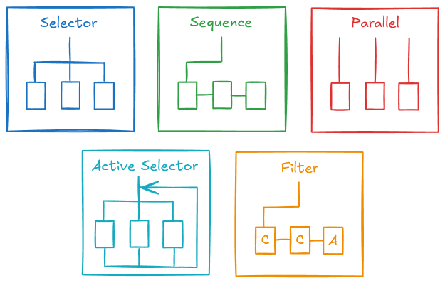
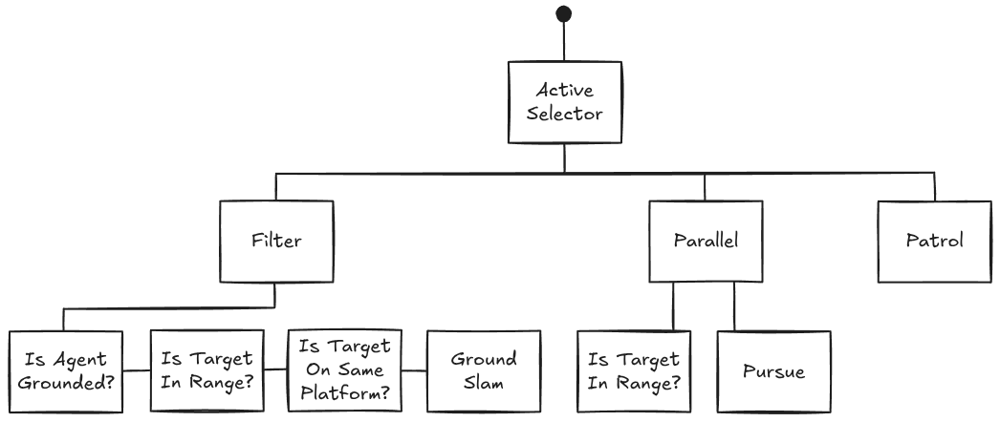

# Dev Log #5: Behavior

*Published on November 13, 2026 by **Nolan Willis***

There are many different behavior selection methods used for NPCs in video games (FSMs, GOAP, HTNs, utility) but in a metroidvanias, behavior trees and finite state machines are probably the most used. Finite state machines are very powerful and could be used for all the NPCs in Clef; however, they get messy when trying to implement complicated behavior, and personally, I find behavior trees much easier to reason about. 

## What's a Behavior Tree?  

A behavior tree is a tree-like structure made up of behaviors that is updated every frame or at a specified constant rate, depending on the game. There is no behavior tree class per se. There are composite behaviors, which have multiple behaviors as children, and use them to create the tree. Behavior trees are sort of “meta behavior selection method”, since other behavior selection methods can be encapsulated in a behavior and added to the tree. 

Since BTs update every frame, large trees, on thousands of enemies will definitely hurt performance, but here the trees are relatively simple and there might be, at max, a hundred being updated at a time. There are more complex, performance focused implementations of behavior trees that utilize things like multithreading, but here the basic implementation will be just fine.   

## The Behavior Class

- `enum BehaviorStatus { SUCCESS, RUNNING, FAILURE }`: denotes the current status of the behavior.  
- `_initialize(_bb: Blackboard) -> void`: sets up initial data and references. 
- `_run(_bb: Blackboard, _delta: float) -> BehaviorStatus`: runs the actual behavior.
- `_terminate(_bb: Blackboard) -> void`: cleans up the behavior. 
- `update(_bb: Blackboard, _delta: float) -> BehaviorStatus`: if the current status is not `RUNNING` call `_initialize(...)`, otherwise call `_run(...)`. Update the current status with the return value of `_run(...)`. If the new current status is not `RUNNING` call `_terminate(...)` otherwise return current status.

## Composite behaviors



- An abstract subclass of Behavior that has an array of children behaviors.
- The root behavior of the tree is always a composite behavior.  
- There a three main composites: 
  - Selector: calls children behavior in order until one succeeds.  
  - Sequence: calls children behavior in order until one fails. Used if you want multiple behaviors to occur in a sequence.   
  - Parallel: calls every child behavior, succeeds if all or one of the children succeeds, fails if all or one of the children fail. Used to run multiple behaviors at once (e.g. you want an NPC to perform an action only when a condition is true.) Despite the name, it's children aren't actually ran at the same time, it's `_run(...)` function just loops through all it's
- Other useful composites:
  - Active Selector: a variation on the selector. Calls `_initialize(...)` in `_run(...)` so the current child index is reset every `update(...)`. Say you want an enemy to attack if they're in range of the player and to pursue if not. The first child would be a sequence with the range check, then attack behavior. The second child would be pursue. When the range check fails, the sequence fails, so pursue runs. In a normal selector, every update will just run pursue, the first child behavior is never reconsidered.
  - Filter: slight variation on the sequence, in fact it's being used in the example above. It exposes an interface for adding condition behaviors and action behaviors. A range filter would be a "condition" and an attack would be an "action". Conditions are added to the front of the child array and actions are added to the back. So every condition must succeed before the actions are run.       

## Blackboards  

An object passed to every behavior in a tree that contains shared data like: a reference to the agent, a reference to a target, the agent’s feet offset, etc. They prevent behavior from having massive constructors with repeat parameters. Every behavior tree has one blackboard for sharing data between behaviors. There are other data sharing methods used with BTs, but this is the one I’ve used/seen the most. The big con of blackboards is that they’re global data stores within the tree, which is why the data is mostly read only to behaviors. Behavior shouldn’t really be updating the values, the agent or owner of the behavior tree should do this. 

### blackboard.gd 

```
## Shares data used by multiple behaviors in a behavior tree. 
class_name Blackboard

## Blackboard Value Key Constants  
const AGENT := &"agent"
## Vector2, offset from the agent's origin to its feet. 
const AGENT_FEET_OFFSET := &"agent_feet_offset"
const HOME_POSITION := &"home_position"
const NAV_ASTAR := &"nav_astar"
## float, how close in px the agent must be to a NavPoint for it to be considered reached.
const NAV_POINT_ACCEPT_RADIUS := &"nav_point_accept_radius"
const NAV_STATS := &"nav_stats"
## float, how far in px the target has to move from where the current path leads before the path is regenerated.
const REPATH_DISTANCE := &"repath_distance"
const TARGET := &"target"
## float, how close in px the agent must get to a destination for it to be considered reached.
const TARGET_ACCEPTANCE_RADIUS := &"target_acceptance_radius"
## Vector2, offset from the target's origin to its feet.
const TARGET_FEET_OFFSET := &"target_feet_offset"

## Signal for alerting other systems (sound, animation, etc) that a value in the blackboard has changed. 
## The behaviors in a behavior tree shouldn't use this, they check for value updates by polling.  
signal value_changed(key: StringName, value: Variant)

# Dictonary to hold values of any type. 
var _data: Dictionary[StringName, BlackboardEntry] = {}

## Declares a blackboard entry with a fixed type, does nothing if an entry with the same type already exists.  
func declare(key: StringName, type: Variant.Type, value: Variant = null) -> void:
	if _data.has(key): 
		if _data[key].type != type:
			push_error("Blackboard key '%s' already declared as %s" % [key, type_string(_data[key].type)])
			return
		return

	_data[key] = BlackboardEntry.new(key, type, value)

func has(key: StringName) -> bool:
	return _data.has(key)

func get_value(key: StringName) -> Variant:
	return _data.get(key).value

func set_value(key: StringName, value: Variant) -> bool: 
	var entry: BlackboardEntry = _data.get(key)
	if entry == null: 
		push_error("Blackboard key '%s' has not been declared" % key)
		return false 

	if entry.value == value:
		return false 

	var result: bool = entry.set_value(value)
	
	if not result: 
		return false 

	value_changed.emit(key, value)
	return true 

func get_type(key: StringName) -> Variant.Type:
	if _data.has(key): 
		return _data[key].type  
	
	return TYPE_NIL 

func erase(key: StringName) -> void: 
	if _data.erase(key):
		value_changed.emit(key, null)
```

### blackboard_entry.gd

```
class_name BlackboardEntry

var key: StringName
var type: Variant.Type
var value: Variant 

func _init(in_key: StringName, in_type: Variant.Type, in_value: Variant = null) -> void:
	key = in_key
	type = in_type
	
	if in_value != null: 
		value = in_value
	else:
		value = type_convert(null, in_type)

func set_value(in_value: Variant) -> bool: 
	if typeof(in_value) != type: 
		push_error("Blackboard key '%s' expects a %s, got a %s" % [key, type_string(type), type_string(typeof(in_value))])
		return false 

	value = in_value 
	return true 
```

This implementation above uses a `Dictionary[StringName, BlackboardEntry]`. Where each `BlackboardEntry` has a `key: StringName`, a `type: Variant.Type`, and a `value: Variant`. It also provides helper functions to ensure that once the type of the `BlackboardEntry` is set, it's value can't be a different type. Gives us a little bit of type safety while accommodating any type.     

## MoveTo Behavior

The MoveTo behavior utilizes the navigation system to steer the agent to a destination. The Patrol and Pursue behaviors have MoveTo as a member, using it to implement their own behavior. The compositional relationship between complex behaviors and more basic ones is very powerful and significantly reduces code duplication.

### How it works: 
- It has a destination variable that is set by the agent or owning behaviors (e.g. Pursue will continuously update destination to the player's location). 
- Also has a path array for holding the generated path from a `NavAStar` object and a path index to keep track of which `NavPoint` we're currently moving towards. 
- In `_initialize(...)`, it gets the required values and references from the Blackboard, which were set by the navigating agent.
- In `_run(...)`, if the agent or `NavAStar` reference is null it returns `FAILURE`. It then calculates the agent's position by adding the agent's global position and feet offset, which ensures the y-value is at floor level (+y is down in Godot). If the agent's position is <= acceptance radius to the destination, if it is, it returns `SUCCESS`. Otherwise it checks if the agent needs a path and is grounded, if they are it calls `find_path(...)` then `_follow_path(...)`. If it makes it to the end of `_run(...)`, it returns `RUNNING`.
- In `_follow_path(...)`, if the path is empty and it hasn't navigated to the last NavPoint, set the agent's `velocity.x` to zero. Otherwise, if it has navigated to the last `NavPoint`, it finds the distance between destination and the agent, then sets the agent’s velocity so it arrives at the destination. If it hasn't navigated to the last NavPoint, it gets the current NavPoint. If the current `NavPoint` has a `NavLink` to the next `NavPoint`, the agents `NavAgentStats` are used to set the agents y velocity. Then it gets the distance between the next `NavPoint` and the agent's and sets the agent's velocity so it arrives at the next `NavPoint`.  
### move_to.gd

```
## Behavior that moves thet agent toward a destination.  

class_name MoveTo
extends Behavior

## Where the agent is moving toward. 
var destination: Vector2

## Path to the destination generated by the navigation system.
var _path: Array[NavPoint] = []
var _path_index = 0

## If the path needs to be generated by the navigation system. Used by parent behaviors that 
## update the destination. 
var _needs_path = true

## True once the last NavPoint is reached. The agent then walks straight toward the destination, since the
## destination is on the same platform as the last point.
var _on_final_leg = false

var _agent: CharacterBody2D
var _astar: NavAStar
var _feet_offset: Vector2
var _nav_point_accept_radius: float
var _target_acceptance_radius: float

func _initialize(_bb: Blackboard) -> void:
	_path.clear()
	_path_index = 0
	_needs_path = true
	_on_final_leg = false
	
	_agent = _bb.get_value(Blackboard.AGENT)
	_astar = _bb.get_value(Blackboard.NAV_ASTAR)
	_feet_offset = _bb.get_value(Blackboard.AGENT_FEET_OFFSET)
	_nav_point_accept_radius = _bb.get_value(Blackboard.NAV_POINT_ACCEPT_RADIUS)
	_target_acceptance_radius = _bb.get_value(Blackboard.TARGET_ACCEPTANCE_RADIUS)


## Called when a new nagivation path should be generated, should be done after updating the destination. 
func repath() -> void:
	_needs_path = true

func _run(_bb: Blackboard, _delta: float) -> BehaviorStatus: 
	if _agent == null or _astar == null:
		return BehaviorStatus.FAILURE

	# If we're within the target acceptance radius of the destination, return SUCCESS.
	var agent_position := _agent.global_position + _feet_offset
	if agent_position.distance_to(destination) <= _target_acceptance_radius:
		return BehaviorStatus.SUCCESS

	# Only path from the floor, otherwise the closest NavPoint to a mid-air position can be misleading.
	if _needs_path and _agent.is_on_floor():
		_needs_path = false
		if not _astar.find_path(agent_position, destination, _path):
			return BehaviorStatus.FAILURE
		_path_index = 0
		# An empty path means no NavPoints are needed, just walk to the destination.
		_on_final_leg = _path.is_empty()

	_follow_path(_delta)
	return BehaviorStatus.RUNNING

func _terminate(_bb: Blackboard) -> void:
	var agent: CharacterBody2D = _bb.get_value(Blackboard.AGENT)
	if agent != null:
		agent.velocity.x = 0.0
	_path.clear()

func _follow_path(delta: float) -> void:
	if _path.is_empty() and not _on_final_leg:
		_agent.velocity.x = 0.0
		return

	var agent_movement_stats: NavAgentStats = _agent.stats

	var on_floor := _agent.is_on_floor()
	
	var max_speed := agent_movement_stats.run_speed if on_floor else agent_movement_stats.air_speed

	# If we've gone to each nav_point in _path, get final_dx, the distance from the destination to the agent. 
	# Get the maximum movement speed. Then we set the target speed to final_dx / delta in a clamp. If 
	# final_dx is big, final_speed will just be the max_speed. If final_dx is small, the final_speed will 
	# be scaled down so the agent arrives at the destination.
	if _on_final_leg:
		var final_dx := destination.x - _agent.global_position.x
		_agent.velocity.x = clampf(final_dx / delta, -max_speed, max_speed)
		return

	var current_nav_point := _path[_path_index]
	var dx := current_nav_point.global_position.x - _agent.global_position.x
	var dy := current_nav_point.global_position.y - (_agent.global_position.y + _feet_offset.y)
	
	# If we've reached the current_nav_point.
	if on_floor and absf(dx) <= _nav_point_accept_radius and absf(dy) <= _nav_point_accept_radius * 2.0:
		# If the current_nav_point is the last nav_point in _path, then we're on the last leg. 
		if _path_index == _path.size() - 1:
			_on_final_leg = true
			return

		# Otherwise get the next nav_point and check for nav_links between the last nav_point and current one. 
		# If a nav_link exsits, and it's a jump, apply the change in y-velocity to the agent.
		_path_index += 1
		current_nav_point = _path[_path_index]
		dx = current_nav_point.global_position.x - _agent.global_position.x
		var link := _path[_path_index - 1].find_nav_link_to(current_nav_point)
		if link != null and link.type == NavLink.Type.JUMP:
			_agent.velocity.y = -agent_movement_stats.speed_for(link)

	# Move the agent along the x-axis. 
	_agent.velocity.x = clampf(dx / delta, -max_speed, max_speed)
```

### Why _on_final_leg? 
A `NavPoint` can’t possibly be at every destination, so it finds a path that gets the agent to the closest `NavPoint`, then just sets the agent's velocity in the direction of the destination, hoping nothing gets in the way.
There is also the backtracking issue discussed in the last dev log. If the start location and last `NavPoint` are on the same `NavPlatform`, NavAStar returns an empty path, implying the agent should just move towards the destination.

### Why _needs_path? 
It prevents future `_run(...)` calls from generating a new path if one has already been generated. Also provides a way for behaviors like Pursue, to tell `MoveTo` to generate a new path.  
 

## Test Enemy Behavior Tree



1. Checks if the agent is grounded, the target is in range of the attack, and the target is on the same platform, then activates the ground slam.
2. If one of the slam checks fails, it moves to the parallel, which runs pursue while checking if the target is in aggro range. 
3. If the target is not in aggro range, then go to patrol. 
4. Then repeat 1 - 3 every update, since the root behavior is an active selector.

### Setup in test_enemy.gd

```
var root := ActiveSelector.new()

# Slam is the highest priority. Once it's running it commits: the conditions aren't re-checked mid-slam.
var slam_filter := Filter.new()
slam_filter.add_condition(IsTargetOnSamePlatform.new())
slam_filter.add_condition(IsTargetInRange.new(slam_distance))
slam_filter.add_condition(IsAgentGrounded.new())
slam_filter.add_action(UseGroundSlam.new(slam))
root.add_child(slam_filter)

# Chase is higher priority than patrol here. A Parallel instead of a Filter so the range condition is re-checked every
# tick. If the target leaves detection range the Parallel fails, Pursue is aborded and the enemy goes back to patrolling. 
# Success needs both children to be successful (in range and arrived).
var chase := Parallel.new(Parallel.ParallelPolicy.REQUIRE_ALL, Parallel.ParallelPolicy.REQUIRE_ONE)
chase.add_child(IsTargetInRange.new(range))
chase.add_child(Pursue.new())
root.add_child(chase)

root.add_child(Patrol.new(points, pause))
```

There’s more initial setup than FSMs, but once the main behaviors are implemented, adding new ones and defining NPC behavior, becomes relatively straightforward. Especially in a metroidvania where most enemies pursue you then use a handful of attacks which depend on some conditions. I’m looking forward to adding new enemies and a boss in the future.
