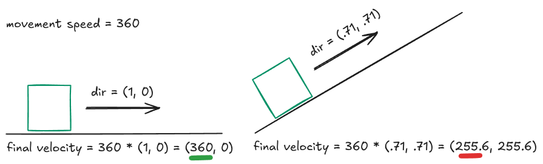
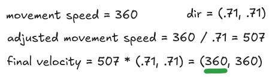
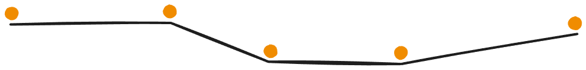
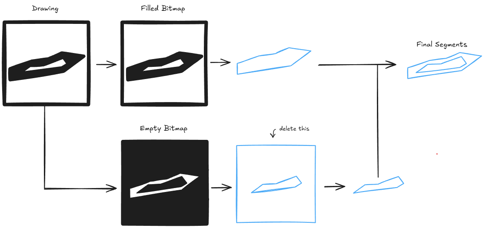
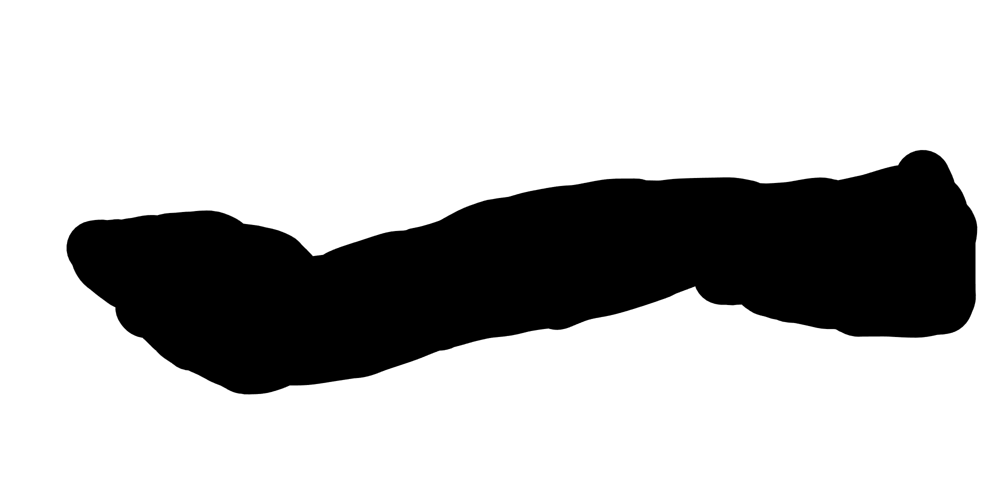
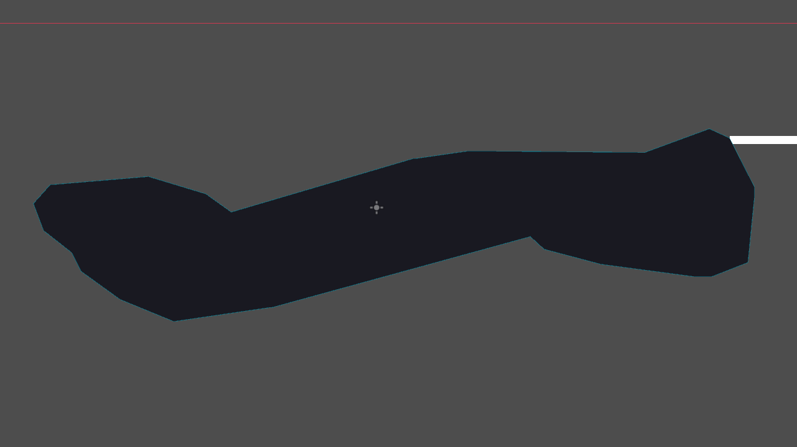

# Dev Log #6: Terrain

*Published on November 20, 2026 by **Nolan Willis***

One of the things I really like about Ori and the Blind Forest games is their terrain. It bends and curves like a real forest floor, supporting the natural, outdoorsy feel of the game. That’s not to say tile-based terrain is bad, in some games like Belmont's Curse or Dead Cells, having tile terrain works well with the locale of the levels — dungeons, castles, and streets instead of a mythical forest. For the musical biomes of Clef it makes sense to support both tile and polygon based terrain. 

The current list is tentative, only part of a biome would be built for a vertical slice:  
Ivory Catacombs: classical, a gothic musical conservatory, tile based. 
Rust-string woods: folk/country, an autumn-hued forest, polygon based.
Weeping Delta: blues, a flooded shantytown/marsh, polygon based.
Brass Labyrinth: jazz, a dark, 1920’s noir city district, tile based. 
Decibel Foundries: rock, a jagged volcanic crater, polygon based. 
Sequencer Spire: house/EDM, a high tech tower, tile based. 

It might make sense just use the polygon approach, since you can make flat rectangles with it just as well. For now though, the vertical slice will be in one of the more outdoor biomes, so there needs to be support for polygon based terrain. 

## What needs to change

When starting out, flat rectangular platforms were used for testing, unfortunately using flat platforms hid some of the nuances that comes with polygon-based terrain. Two main things needed to be changed: 
The players walk movement state and the move-to behavior both assume horizontal movement is across flat platforms. 
The navigation system needs to rework NavPlatforms and any function that depends on the concept of levels.       

## What is being added

A tool that takes a black and white image -- where filled in space is one color and empty space is another -- and generates a custom polygon collider by loosely tracing the terrain shape with straight segments. It should also be able to color-in the collider and export it as a saved scene for testing and because there’s no art yet.                                 
 
## Horizontal Movement

Just to clarify, in this case movement speed is the desired x-component of the final velocity vector (ignoring signs here). For movement that feels good, it should remain consistent unless for a specific reason (knockback, slowdown fields, other special effects). 

With flat ground horizontal movement is super easy, which is one of the reasons grid based approaches are used. If something needs to move left or right, the movement speed is multiplied by Vector2D.Right (1, 0) ) or Vector2D.Left (-1, 0) and that's the final velocity. However,  if the ground is on a slant, say at a 45 degree angle, the direction vector is (.71, .71), so multiplying movement speed by the direction vector no longer works.  



To solve this, the movement speed needs to be adjusted before multiplying by the direction vector, so the final velocity x-component consistently matches the specified movement speed. The adjusted movement speed is simply the desired movement speed divided by the x-component of the direction vector.  One thing to note, yes the y-component will also be scaled. This is good, if it wasn't, the slope would change. The ratio between the x and y component of the direction vector is what creates the slope in the first place. 



## Navigation

Instead of NavPlatforms there will be NavPolylines with NavPoints at each vertex. In this new version, NavPoints are not automatically generated, this might be added in the future but it seemed more like a want than a need.  



Navigation works almost exactly the same way, except the concept of platform levels is gone. The only place where it was used was in find_path(...), when finding the closest NavPoint to the start position. It would look  for the closest NavPoint on the same platform as the start position. If it couldn't find one, it would look for the closest NavPoint on the same platform level as the start position. This backup was only used if the start position was mid-air and too far to be considered on a platform.  It was replaced with the closest overall NavPoint. 

## Terrain System  

How it works: 
1. Take the pixels from a black/white image, create a bitmap of the same size. 
2. Create two bitmaps: a filled bitmap, where solid pixels are turned on matching the pixels, and an empty bitmap which is the inverse. 
3. Call opaque_to_polygon(...) on both.  
4. Discard the segments from the empty bitmap that touch the edge of the bitmap. 
5. Use the resulting segments to create a ConcavePolygonShape2D using the polygon segments.  
6. Finally, create a CollisionShape2D, using the ConcavePolygonShape2D.



Why two bitmaps?
The problem with opaque_to_polygon(...) is that it only wraps the exterior of on blobs, if there is a hole on the inside of it will be ignored. Having two bitmaps solves this. If there isn’t terrain with holes — after all a cave can be made by combining multiple polygons — one bitmap would be fine. 

### terrain_generator.gd
The overview above skips some steps, like how to deal with nested holes (e.g. an island inside a cave), adding a 1 bit border to detect the segments to discard, how to draw the polygons, and saving it all into a scene. Below is the entire script, which has a bunch of comments that go into more detail. 

```
## Editor tool that generates a black/white image into terrain. White pixels are solid by default.
## Traces the outline of the solid area, simplifies it to line segments, then builds a static mesh from the filled
## area and static collision from the segments. All the collision is on the ground layer.
##
## Set a source image and a scene name, then press Generate in the inspector. The terrain is saved as its own scene in the
## output folder, which you can place in the map like any other. Generating again overwrites that scene. Nothing is
## added to the scene this node is in.

@tool
class_name TerrainGenerator
extends Node2D

const MESH_NAME := "TerrainMesh"
const GROUND_NAME := "Ground"

const GROUND_LAYER := 1

## The black/white image to generate.
@export var source: Texture2D
## Name of the scene to save the terrain as. Generating overwrites a scene with the same name.
@export var scene_name := ""
## The folder the scene is saved in.
@export_dir var output_directory := "res://level/terrain"
## If true, white pixels are solid. If false, black pixels are.
@export var white_is_solid := true
## Brightness (0-1) at or above which a pixel counts as white.
@export_range(0.0, 1.0) var threshold := 0.5
## World units per image pixel.
@export var pixel_scale := 1.0
## If true, the image's center is placed at this node's origin. Otherwise its top left corner is.
@export var centered := true
## How far (in pixels) the outline may stray from the image. Higher gives fewer, longer segments.
@export_range(0.0, 25.0, 1.0) var simplify_epsilon := 15.0
## Edges shorter than this (in pixels) are merged into their neighbors. Removes the tiny jogs the outline gets from
## pixel steps, which the player can catch on.
@export_range(0.0, 20.0, 0.5) var min_segment_length := 4.0
## Solid blobs and holes smaller than this (in square pixels) are dropped.
@export var min_area := 16.0
## If true, builds a mesh that fills the solid area. Turn off to generate only the collision, for when the art is hand drawn.
@export var build_mesh := true
## The terrain mesh color.
@export var color := Color(0.1, 0.1, 0.13)
## What the terrain collides with. Matches the other level pieces (the player).
@export_flags_2d_physics var collision_mask := 8
@export_tool_button("Generate") var generate_button := generate


## Generates the terrain from the source image.
func generate() -> void:
	if source == null:
		push_error("TerrainGenerator '%s' has no source image." % name)
		return
	# Get the image from the source Texture2D.
	var image := source.get_image()
	if image == null:
		push_error("TerrainGenerator '%s' couldn't read its source image." % name)
		return

	# If the image is compressed, decompress it. 
	if image.is_compressed():
		image.decompress()

	var file_name := scene_name.validate_filename()
	if file_name.is_empty():
		push_error("TerrainGenerator '%s' has no scene name." % name)
		return

	# Get the polygons that trace around the solid area.  
	var polygons := _trace(image)
	if polygons.is_empty():
		push_warning("TerrainGenerator '%s' found no solid area." % name)
		return

	var shells := _group_polygons(polygons)

	# The terrain is built under its own root, which becomes the saved scene's root.
	var root := Node2D.new()
	root.name = file_name

	if build_mesh:
		_build_mesh(root, shells, image.get_size())

	_build_collision(root, shells, image.get_size())

	print("TerrainGenerator '%s': generated %d shapes from %d outline loops." % [name, shells.size(), polygons.size()])

	_save_scene(root, output_directory.path_join(file_name + ".tscn"))
	root.free()

# Saves the root as a scene at the path.
func _save_scene(root: Node2D, path: String) -> void:
	var packed := PackedScene.new()
	var error := packed.pack(root)
	if error == OK:
		DirAccess.make_dir_recursive_absolute(path.get_base_dir())
		error = ResourceSaver.save(packed, path)
	if error != OK:
		push_error("TerrainGenerator '%s' couldn't save '%s': %s" % [name, path, error_string(error)])
		return
	if Engine.is_editor_hint():
		EditorInterface.get_resource_filesystem().scan()
	print("TerrainGenerator '%s': saved '%s'." % [name, path])

# Adds a node under the root, as part of the scene that will be saved.
func _adopt(node: Node, root: Node) -> void:
	root.add_child(node)
	node.owner = root

# Returns the simplified outline polygons of the solid area, in pixel coordinates. That's the outer edge of every solid
# blob (cluster of solid pixels) plus the edge of every hole inside the blob.
func _trace(image: Image) -> Array[PackedVector2Array]:
	# Create the bitmaps
	# Get the width and height of the image. 
	var size: Vector2i = image.get_size()
	var solid := BitMap.new()
	# Flips the colors, so the empty part is now "solid" with a 1 px solid frame around it. 
	# Everything empty that touches the image edge joins the frame, so the only other loops it has are holes.
	var empty := BitMap.new()
	solid.create(size)
	# The emtpy bitmap is bits more in width and height, leaving room for a 1 bit boarder turned on in the 
	# empty map (so technically empty). 
	empty.create(size + Vector2i(2, 2))
	empty.set_bit_rect(Rect2i(Vector2i.ZERO, empty.get_size()), true)

	# Fill the bitmaps 
	# For each pixel, determine it's luminance value (how light/dark it is), if it's above 
	# a certain threshold count it as bright. If it's bright, white is considered solid, and
	# it's not transparent, the pixel is solid. If it's bright and white is considered empty,
	# the pixel is empty.  
	for y in size.y:
		for x in size.x:
			var pixel_color: Color = image.get_pixel(x, y)
			var bright: bool = pixel_color.get_luminance() >= threshold
			# Transparent pixels count as empty.
			var is_solid := (bright == white_is_solid) and pixel_color.a >= 0.5
			# Set the corresponding bit in the solid bitmap based on is_solid.  
			solid.set_bit(x, y, is_solid)
			# Set the corresponding bit in the flipped bitmap, to the opposite of is_solid. So if the 
			# bit is on in solid map, turn it off. If the bit is off in the solid map, turn it on. 
			# The +1 here leaves room for one pixel border. 
			empty.set_bit(x + 1, y + 1, not is_solid)

	# Get the polygons 
	var polygons: Array[PackedVector2Array] = []
	# Takes a bitmap and returns the boundary of each connected "on" blob (a cluster of bits that are turned on) 
	# as a polygon. Uses the Douglas-Peucker line simplification algorithm with the given epsilon value to reduce 
	# the number of points in the polygon, thus reducing the number of line segments.  
	for polygon: PackedVector2Array in solid.opaque_to_polygons(Rect2i(Vector2i.ZERO, size), simplify_epsilon):
		polygons.append(polygon)
	# Do the same thing for the empty bitmap. There are two types of polygons returned. The large one connected to 
	# the edge of the bitmap, that fills in the "background" of the solid bitmap. And the enclosed cavities that 
	# are empty areas surrounded by solid. We want to discard the background, so we check if the polygon has area 
	# and does not go through (0, 0) which is in the background polygon. 
	for polygon: PackedVector2Array in empty.opaque_to_polygons(Rect2i(Vector2i.ZERO, empty.get_size()), simplify_epsilon):
		if polygon.size() >= 3 and not polygon.has(Vector2.ZERO):
			# _shifted here puts the polygons back in the images original coordinates, removing the +1 added earlier. 
			polygons.append(_shifted(polygon, Vector2.ONE))

	# Only keep polygons that have an area above a certain value  
	var kept_polygons: Array[PackedVector2Array] = []
	for polygon: PackedVector2Array in polygons:
		var cleaned := _merge_short_edges(polygon)
		if cleaned.size() >= 3 and absf(_get_area_and_winding(cleaned)) >= min_area:
			kept_polygons.append(cleaned)
	
	return kept_polygons

# Shifts the points in the polygon by the x and y specified in shift_amount.  
# Joins the two ends of every edge shorter than min_segment_length at their midpoint, until none are left.
func _merge_short_edges(loop: PackedVector2Array) -> PackedVector2Array:
	var points := Array(loop)
	var merged := true
	while merged and points.size() > 3:
		merged = false
		for i in points.size():
			var next := (i + 1) % points.size()
			if points[i].distance_to(points[next]) < min_segment_length:
				points[i] = (points[i] + points[next]) * 0.5
				points.remove_at(next)
				merged = true
				break
	return PackedVector2Array(points)

func _shifted(polygon: PackedVector2Array, shift_amount: Vector2) -> PackedVector2Array:
	var result := PackedVector2Array()
	for point in polygon:
		result.append(point - shift_amount)
	return result

# Gets the area of the given polygon. Positive when the polygon runs visually clockwise (the y axis points down),
# negative otherwise. The sign can be ignored for just getting the area. 
func _get_area_and_winding(polygon: PackedVector2Array) -> float:
	var sum := 0.0
	for i in polygon.size():
		var a := polygon[i]
		var b := polygon[(i + 1) % polygon.size()]
		sum += a.x * b.y - b.x * a.y
	return sum * 0.5

# Groups polygons into shells. Each shell consists of {outer polygon, hole polygons}. Outers are made
# visually clockwise and holes counter-clockwise, so the solid shell is always on the same side of every edge.
func _group_polygons(polygons: Array[PackedVector2Array]) -> Array[Dictionary]:
	# How deep polygon is (how many polygons it's inside of).   
	# Depth also tells you what each polygon is:
	# - 0: inside nothing. It's the outer edge of a solid blob.
	# - 1: inside one solid loop. It's a hole.
	# - 2: inside a hole inside a solid. It's an island sitting in a cavity, so solid again.
	# - And so on. Even depth is solid, odd depth is a hole.
	var depth: Array[int] = []

	# Containers[i] is an array, of all the polygons (their indices) that contain polygon i. 
	# E.g. containers[0] = [1, 2, 5], polygon 0 sits in polygon 5, polygon 5 sits in polygon 2, 
	# and polygon 2 sits in polygon 1. Polygon 0 is said to have a depth of 3. 
	var containers: Array[Array] = []

	# For every polygon i, find all the polygons that contain i. Polygons are closed "loops" here 
	# so every polygon found is another depth level. 
	for i in polygons.size():
		var inside: Array[int] = []
		for j in polygons.size():
			if i != j and Geometry2D.is_point_in_polygon(polygons[i][0], polygons[j]):
				inside.append(j)
		containers.append(inside)
		depth.append(inside.size())

	# With the depth and containers found for each polygon, assemble shells consisting of an outer polygon 
	# and their holes (inner polygons).  
	var shells: Array[Dictionary] = []
	var shell_of := {}
	# For each polygon i, if its depth is even, it's an outer or solid polygon, so add new shell with i as the outer
	# polygon.  
	for i in polygons.size():
		if depth[i] % 2 == 0:
			shell_of[i] = shells.size()
			shells.append({"outer": _oriented(polygons[i], true), "holes": []})
	# For each polygon i, look through it's containers, if the depth of a container polygon j, had a depht one less than i's, 
	# then j is first polygon containing i or it's "parent". So add polygon i as a hole for polygon j.        
	for i in polygons.size():
		if depth[i] % 2 == 1:
			for j in containers[i]:
				if depth[j] == depth[i] - 1:
					shells[shell_of[j]].holes.append(_oriented(polygons[i], false))

	# Outer polygons are wound clockwise and hole polygons counter-clockwise, reversing a polygon's point order if needed.
	# The hole has to run the opposite way from its outer polygon when it's joined to it for triangulating the mesh.

	return shells

# If the polygon has the opposite winding than what we want, reverse it so it has the correct winding.
func _oriented(polygon: PackedVector2Array, clockwise: bool) -> PackedVector2Array:
	if (_get_area_and_winding(polygon) > 0.0) == clockwise:
		return polygon
	var reversed := polygon.duplicate()
	reversed.reverse()
	return reversed

# Makes one static body that holds the segments of every polygon in a single shape.
func _build_collision(root: Node2D, shells: Array[Dictionary], image_size: Vector2i) -> void:
	var segments := PackedVector2Array()

	for shell in shells:
		# Put all the polygons in a single array.
		var polygons: Array = [shell.outer]
		polygons.append_array(shell.holes)
		# Each pair of neighboring points is a segment. Convert them to world space.
		for polygon: PackedVector2Array in polygons:
			for i in polygon.size():
				var a := _to_world(polygon[i], image_size)
				var b := _to_world(polygon[(i + 1) % polygon.size()], image_size)
				if a.is_equal_approx(b):
					continue
				segments.append(a)
				segments.append(b)

	_add_body(root, GROUND_NAME, GROUND_LAYER, segments)

# Creates a StaticBody2D at the root, with a CollisionShape2D node that uses a ConcavePolygonShape2D built from the 
# passed in line segments.  
func _add_body(root: Node2D, body_name: String, layer: int, segments: PackedVector2Array) -> void:
	if segments.is_empty():
		return
	
	var shape := ConcavePolygonShape2D.new()
	shape.segments = segments
	
	var collision := CollisionShape2D.new()
	collision.name = "CollisionShape2D"
	collision.shape = shape
	
	var body := StaticBody2D.new()
	body.name = body_name
	body.collision_layer = layer
	body.collision_mask = collision_mask

	_adopt(body, root)
	body.add_child(collision)
	collision.owner = body.owner

func _build_mesh(root: Node2D, shells: Array[Dictionary], image_size: Vector2i) -> void:
	var vertices := PackedVector2Array()
	var indices := PackedInt32Array()
	for shell in shells:
		var polygon := _bridge_holes(shell.outer, shell.holes)
		var triangles := Geometry2D.triangulate_polygon(polygon)
		if triangles.is_empty():
			push_warning("TerrainGenerator '%s' couldn't triangulate one shape. It will be missing from the mesh." % name)
			continue
		var base := vertices.size()
		for point in polygon:
			vertices.append(_to_world(point, image_size))
		for index in triangles:
			indices.append(base + index)

	var arrays := []
	arrays.resize(Mesh.ARRAY_MAX)
	arrays[Mesh.ARRAY_VERTEX] = vertices
	arrays[Mesh.ARRAY_INDEX] = indices
	var mesh := ArrayMesh.new()
	mesh.add_surface_from_arrays(Mesh.PRIMITIVE_TRIANGLES, arrays)

	var instance := MeshInstance2D.new()
	instance.name = MESH_NAME
	instance.mesh = mesh
	instance.modulate = color
	_adopt(instance, root)

func _to_world(point: Vector2, image_size: Vector2i) -> Vector2:
	var offset := Vector2(image_size) * 0.5 if centered else Vector2.ZERO
	return (point - offset) * pixel_scale

# Merges holes into the outer loop by connecting each to it with a pair of coincident edges, so the result
# is one polygon that can be rasterized. Holes are done right to left so earlier bridges can't block later ones.
func _bridge_holes(outer: PackedVector2Array, holes: Array) -> PackedVector2Array:
	var polygon := outer
	var pending := holes.duplicate()
	pending.sort_custom(func(a: PackedVector2Array, b: PackedVector2Array) -> bool:
		return _rightmost(a).x > _rightmost(b).x)

	for hole: PackedVector2Array in pending:
		var hole_index := _rightmost_index(hole)
		var hole_point := hole[hole_index]
		var others: Array = pending.filter(func(h: PackedVector2Array) -> bool: return h != hole)

		# Connect to the nearest outer point that has a clear line to the hole.
		var order := range(polygon.size())
		order.sort_custom(func(a: int, b: int) -> bool:
			return polygon[a].distance_squared_to(hole_point) < polygon[b].distance_squared_to(hole_point))
		var outer_index := -1
		for candidate: int in order:
			if _is_clear(hole_point, polygon[candidate], polygon, others + [hole]):
				outer_index = candidate
				break
		if outer_index == -1:
			push_warning("TerrainGenerator '%s' couldn't connect a hole to its shape." % name)
			continue

		var merged := PackedVector2Array()
		for i in outer_index + 1:
			merged.append(polygon[i])
		for i in hole.size() + 1:
			merged.append(hole[(hole_index + i) % hole.size()])
		for i in range(outer_index, polygon.size()):
			merged.append(polygon[i])
		polygon = merged
	return polygon


# True if the line from a to b doesn't cross any edge of the polygon or the loops. Edges that touch an end are ignored.
func _is_clear(a: Vector2, b: Vector2, polygon: PackedVector2Array, loops: Array) -> bool:
	var all: Array = [polygon]
	all.append_array(loops)
	for loop: PackedVector2Array in all:
		for i in loop.size():
			var p := loop[i]
			var q := loop[(i + 1) % loop.size()]
			if p == a or p == b or q == a or q == b:
				continue
			if Geometry2D.segment_intersects_segment(a, b, p, q) != null:
				return false
	return true

func _rightmost_index(loop: PackedVector2Array) -> int:
	var best := 0
	for i in loop.size():
		if loop[i].x > loop[best].x:
			best = i
	return best

func _rightmost(loop: PackedVector2Array) -> Vector2:
	return loop[_rightmost_index(loop)]

```

Conceptually the generator was much easier than I anticipated, the hard part was getting the proper segments, which was made significantly more complex by the nested holes. In hind sight I probably could’ve left it out, seeing how it might not be used and there are simple workarounds. Below is an example of a terrain image I imported into the game using the terrapin generator: 




